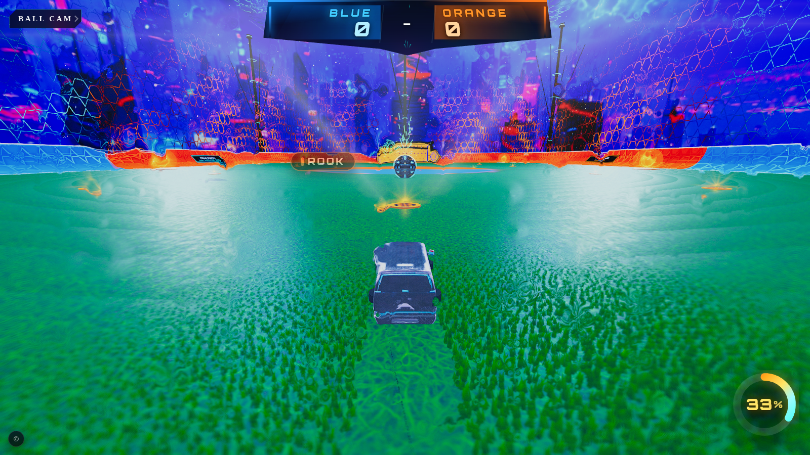
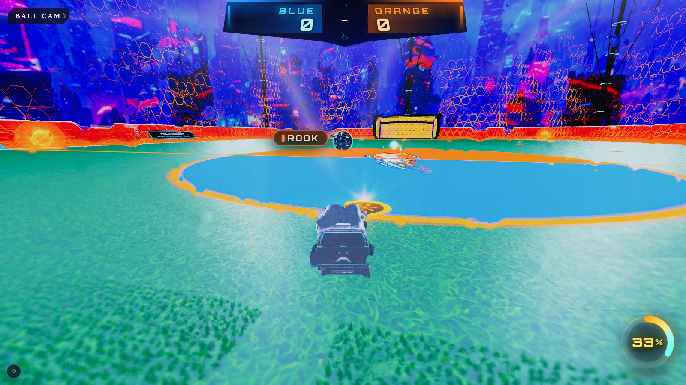
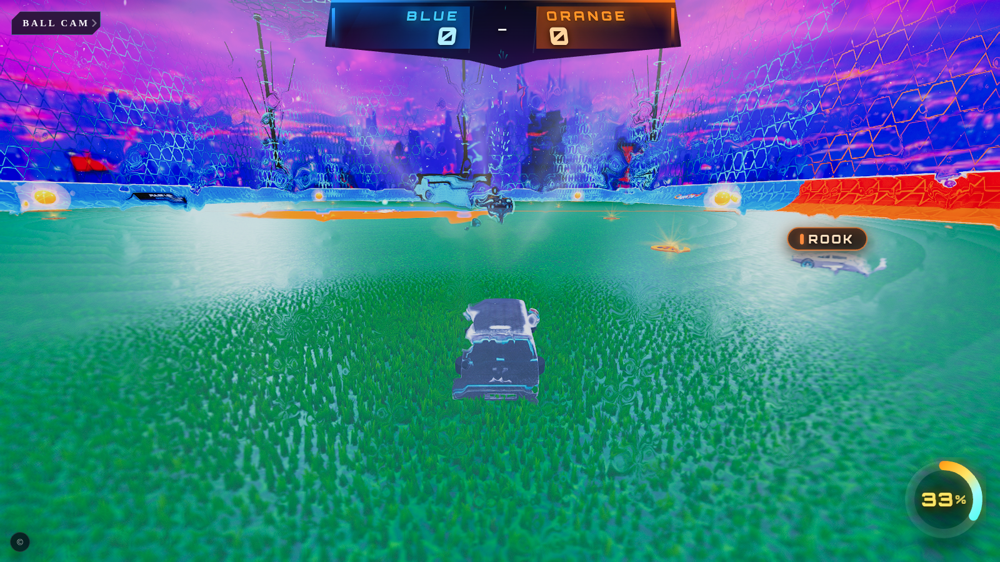
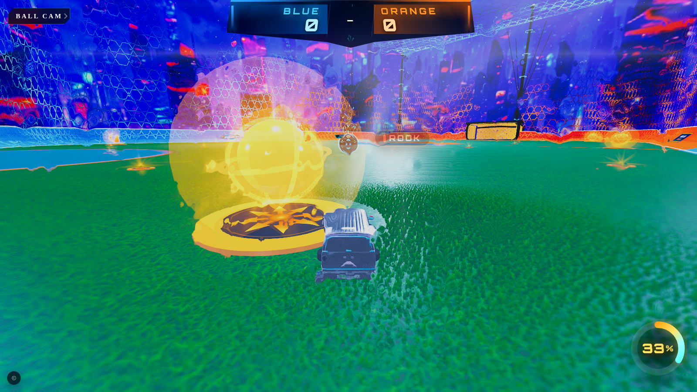
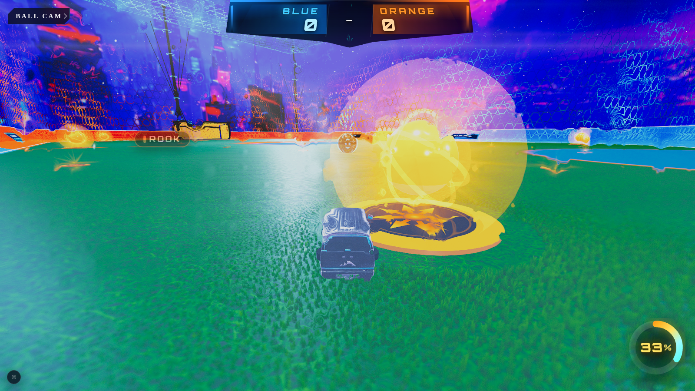
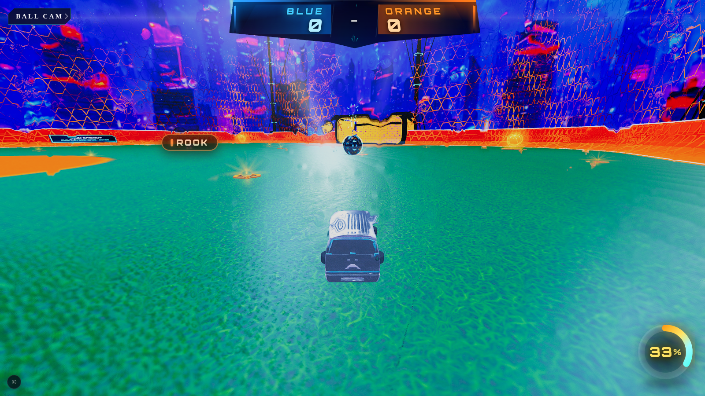
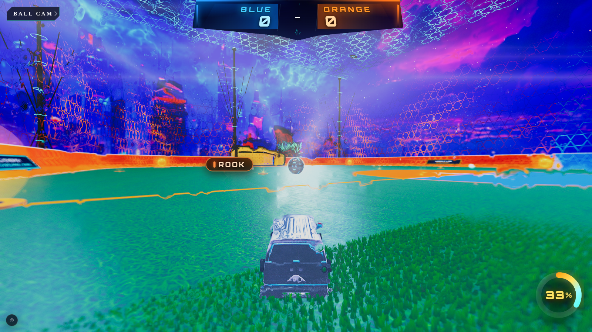
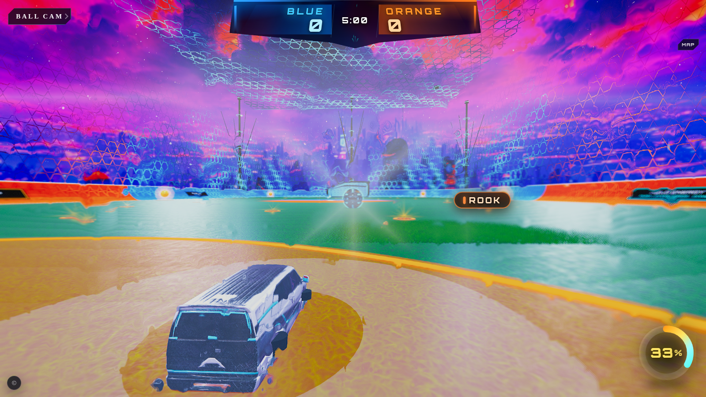
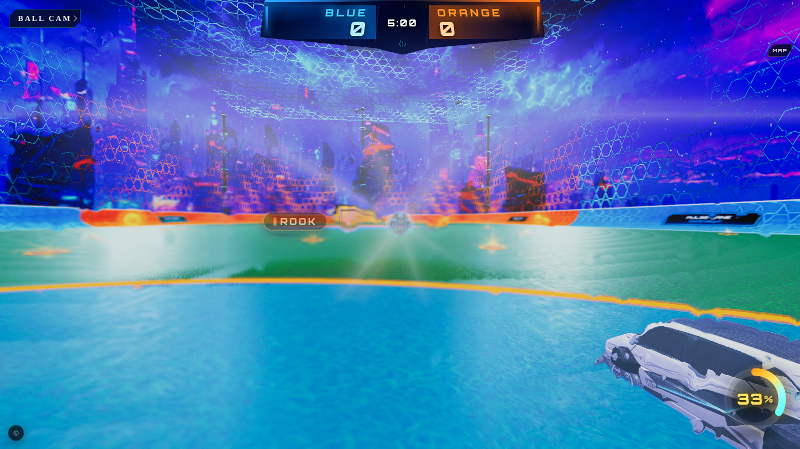
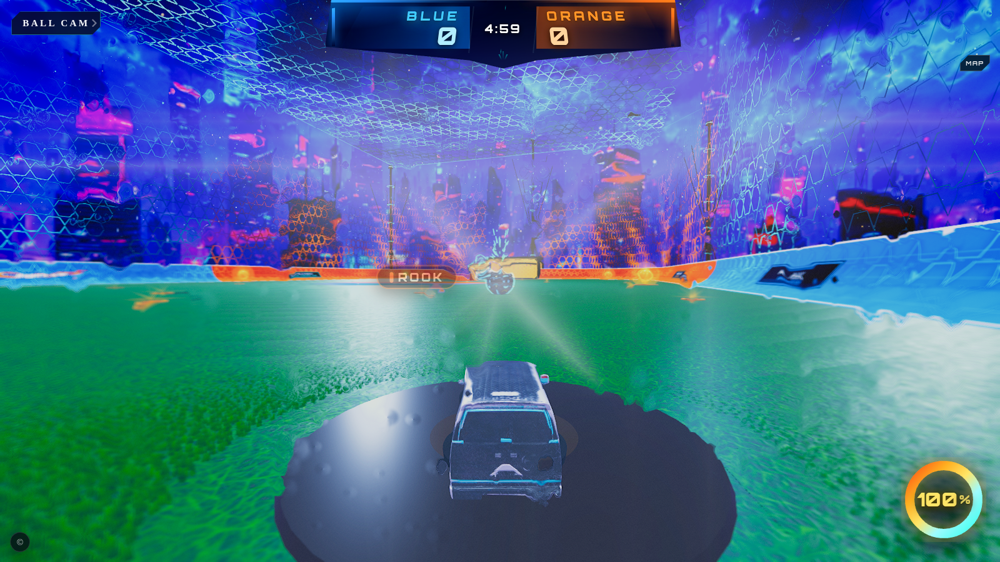

# Chase camera audit

- **PASS:** true
- target: `vite` path: `autostart` survey: true
- fails: —
- screenshot: `/home/adam/Dokumenty/Projekty/Ignite/test-results/chase-camera/chase-vite-autostart-2026-08-31T18-53-07-622Z.png`

## Field survey

### kickoff-blue — PASS

- fails: —
- dist: 2.99
- ndc: {"x":0,"y":-0.49359297895132204,"z":0.7498657321668896}
- car: {"x":0,"y":0.44999998807907104,"z":-40}
- cam: {"x":0,"y":1.5587499883572262,"z":-42.78,"fov":75.49513555607798,"aspect":1.7777777777777777}
- pixel: {"rgb":[0,125,25],"kind":"grass","canvas":"present","washN":0,"grassN":25,"darkN":0,"otherN":0}
- frameWashout: 0.04
- 

### midfield — PASS

- fails: —
- dist: 2.99
- ndc: {"x":2.308136825216856e-16,"y":-0.4935929789513209,"z":0.7498657321668902}
- car: {"x":0,"y":0.44999998807907104,"z":-14}
- cam: {"x":-0.6877830067275738,"y":1.5587499883572262,"z":-16.693576532355593,"fov":75.49513555607798,"aspect":1.7777777777777777}
- pixel: {"rgb":[0,144,82],"kind":"grass","canvas":"present","washN":0,"grassN":25,"darkN":0,"otherN":0}
- frameWashout: 0.04
- 

### orange-half — PASS

- fails: —
- dist: 2.99
- ndc: {"x":-4.616273650433712e-16,"y":-0.4935929789513208,"z":0.7498657321668902}
- car: {"x":12,"y":0.44999998807907104,"z":35}
- cam: {"x":12,"y":1.5587499883572262,"z":37.78,"fov":75.49513555607798,"aspect":1.7777777777777777}
- pixel: {"rgb":[65,181,160],"kind":"grass","canvas":"present","washN":0,"grassN":19,"darkN":0,"otherN":6}
- frameWashout: 0.08
- 

### blue-corner-L — PASS

- fails: —
- dist: 2.99
- ndc: {"x":1.3848820951301103e-15,"y":-0.4935929789513197,"z":0.749865732166891}
- car: {"x":-32,"y":0.44999998807907104,"z":-48}
- cam: {"x":-33.994249932700676,"y":1.5587499883572262,"z":-49.93684465198512,"fov":75.49513555607798,"aspect":1.7777777777777777}
- pixel: {"rgb":[15,129,77],"kind":"grass","canvas":"present","washN":0,"grassN":24,"darkN":0,"otherN":1}
- frameWashout: 0.00
- 

### blue-corner-R — PASS

- fails: —
- dist: 2.99
- ndc: {"x":-1.3848820951301103e-15,"y":-0.4935929789513197,"z":0.749865732166891}
- car: {"x":32,"y":0.44999998807907104,"z":-48}
- cam: {"x":33.994249932700676,"y":1.5587499883572262,"z":-49.93684465198512,"fov":75.49513555607798,"aspect":1.7777777777777777}
- pixel: {"rgb":[3,127,76],"kind":"grass","canvas":"present","washN":0,"grassN":23,"darkN":0,"otherN":2}
- frameWashout: 0.04
- 

### sideline-L — PASS

- fails: —
- dist: 2.99
- ndc: {"x":9.232547300867425e-16,"y":-0.49359297895132076,"z":0.7498657321668902}
- car: {"x":-28,"y":0.44999998807907104,"z":8}
- cam: {"x":-29.453070496427234,"y":1.5587499883572262,"z":5.629981828674574,"fov":75.49513555607798,"aspect":1.7777777777777777}
- pixel: {"rgb":[19,127,87],"kind":"grass","canvas":"present","washN":0,"grassN":25,"darkN":0,"otherN":0}
- frameWashout: 0.04
- 

### sideline-R — PASS

- fails: —
- dist: 2.99
- ndc: {"x":-1.846509460173485e-15,"y":-0.49359297895132076,"z":0.7498657321668902}
- car: {"x":28,"y":0.44999998807907104,"z":-8}
- cam: {"x":29.453070496427234,"y":1.5587499883572262,"z":-10.370018171325427,"fov":75.49513555607798,"aspect":1.7777777777777777}
- pixel: {"rgb":[22,155,119],"kind":"grass","canvas":"present","washN":0,"grassN":24,"darkN":0,"otherN":1}
- frameWashout: 0.00
- 

### orange-goal — PASS

- fails: —
- dist: 2.99
- ndc: {"x":-2.308136825216856e-16,"y":-0.4935929789513208,"z":0.7498657321668902}
- car: {"x":6,"y":0.44999998807907104,"z":50}
- cam: {"x":6,"y":1.5587499883572262,"z":52.78,"fov":75.49513555607798,"aspect":1.7777777777777777}
- pixel: {"rgb":[53,76,121],"kind":"other","canvas":"present","washN":0,"grassN":0,"darkN":0,"otherN":25}
- frameWashout: 0.00
- 

### blue-goal — PASS

- fails: —
- dist: 2.99
- ndc: {"x":-2.308136825216856e-16,"y":-0.49359297895132076,"z":0.7498657321668902}
- car: {"x":-6,"y":0.44999998807907104,"z":-50}
- cam: {"x":-6,"y":1.5587499883572262,"z":-52.78,"fov":75.49513555607798,"aspect":1.7777777777777777}
- pixel: {"rgb":[175,129,24],"kind":"other","canvas":"present","washN":0,"grassN":0,"darkN":0,"otherN":25}
- frameWashout: 0.00
- 

### near-jupiter — PASS

- fails: —
- dist: 2.99
- ndc: {"x":0,"y":-0.49359297895132076,"z":0.7498657321668902}
- car: {"x":-30,"y":0.44999998807907104,"z":-48}
- cam: {"x":-30.821546174518524,"y":1.5587499883572262,"z":-50.655835439769184,"fov":75.49513555607798,"aspect":1.7777777777777777}
- pixel: {"rgb":[0,145,196],"kind":"other","canvas":"present","washN":0,"grassN":0,"darkN":0,"otherN":25}
- frameWashout: 0.04
- 
